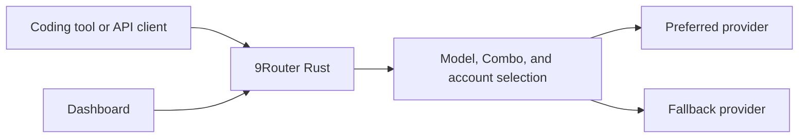

<a id="readme-top"></a>

<div align="center">
  <a href="https://github.com/CoolLoong/9router-rs">
    
  </a>
  <h1>9Router Rust</h1>
  <p>A self-hosted Rust gateway for coding tools and model APIs.</p>
  <p>Migrated with <a href="https://github.com/erkamyaman/rust-anything">rust-anything</a>.</p>
  <p>
    <a href="#getting-started">Getting Started</a> ·
    <a href="docs/native-packages.md">Native packages</a> ·
    <a href="https://github.com/CoolLoong/9router-rs/issues">Issues</a> ·
    <a href="README.zh-CN.md">简体中文</a>
  </p>
</div>

[![Rust][rust-badge]][rust-site]
[![MIT][license-badge]][project-license]

<details>
  <summary>Table of Contents</summary>
<ol>
  <li><a href="#about-the-project">About the Project</a>
    <ul>
      <li><a href="#built-with">Built With</a></li>
    </ul>
  </li>
  <li><a href="#getting-started">Getting Started</a>
    <ul>
      <li><a href="#prerequisites">Prerequisites</a></li>
      <li><a href="#installation">Installation</a></li>
    </ul>
  </li>
  <li><a href="#usage">Usage</a>
    <ul>
      <li><a href="#connect-an-account">Connect an Account</a></li>
      <li><a href="#clients-and-providers">Clients and Providers</a></li>
      <li><a href="#api-reference">API Reference</a></li>
      <li><a href="#deployment-and-data">Deployment and Data</a></li>
      <li><a href="#troubleshooting">Troubleshooting</a></li>
    </ul>
  </li>
  <li><a href="#roadmap">Roadmap</a></li>
  <li><a href="#contributing">Contributing</a></li>
  <li><a href="#license">License</a></li>
  <li><a href="#contact">Contact</a></li>
  <li><a href="#acknowledgments">Acknowledgments</a></li>
</ol>
</details>

## About the Project

Configure your model provider accounts in one gateway, then connect Claude Code, Codex, Cursor, Cline, or an SDK with a gateway URL and key. The native executable includes the dashboard and CLI.



The model ID or Combo name determines which account handles a request. The gateway translates between client and upstream formats. Configure a Combo to try another model when the first one is unavailable or rate-limited.

| Feature | What you can configure |
| --- | --- |
| Routing | Multi-account selection, round-robin, ordered fallback, model aliases, and Combos |
| Credentials | OAuth connections, provider API keys, token refresh, and gateway keys with access restrictions |
| Protocols | OpenAI Chat Completions and Responses, Anthropic Messages, Gemini, and Ollama |
| Media and web | Embeddings, image and video generation, speech synthesis, transcription, web search, and web fetch |
| Monitoring | Quota tracking, usage history, pricing estimates, and optional request logs |
| Token saving | RTK for supported tool outputs and Headroom integration for request compression |
| Administration | Proxy pools, Cloudflare Tunnel, Tailscale, password and SSO login, and SQLite backup and restore |

### Built With

| Component | Role |
| --- | --- |
| [Rust][rust-site] and Cargo | Gateway, CLI, and native packaging |
| Axum and Tokio | HTTP service and asynchronous request handling |
| SQLite | Storage for accounts, Combos, keys, and usage |

<p align="right"><a href="#readme-top">↑ Top</a></p>

## Getting Started

### Prerequisites

- A stable [Rust toolchain with Cargo][rust-site]
- Node.js 22 and npm for the dashboard build
- A C compiler and linker for bundled dependencies such as SQLite
- Docker and Compose for container deployments

### Installation

```sh
git clone https://github.com/CoolLoong/9router-rs.git
cd 9router-rs
npm --prefix dashboard ci
npm --prefix dashboard run build
cargo build --release --locked
```

Start a local gateway with a separate data directory on Linux or macOS.

```sh
DATA_DIR="$HOME/.9router-rs" ./target/release/ninerouter --host 127.0.0.1 --port 20128 --no-browser
```

On Windows, run the executable from PowerShell.

```powershell
$env:DATA_DIR = Join-Path $HOME ".9router-rs"
.\target\release\ninerouter.exe --host 127.0.0.1 --port 20128 --no-browser
```

<p align="right"><a href="#readme-top">↑ Top</a></p>

## Usage

### Connect an Account

1. Open the dashboard and sign in. On a fresh local installation, set `INITIAL_PASSWORD` before launch or sign in with `123456` and change it under **Profile & Settings**. [Dashboard](http://127.0.0.1:20128/dashboard)
2. Open **Providers**, add an account, and pick a model from **Models**. Use **Basic Chat** to try the connection.
3. Create a gateway key in **Endpoint & Key**. Configure your client with base URL `http://127.0.0.1:20128/v1`, the gateway key, and the full model ID shown in the catalog.

### Clients and Providers

The dashboard's **CLI Tools** page manages tool-specific settings. The binary can also configure Claude Code, Codex, OpenCode, Droid, Crush, Kilo, Cline, Pi, and OMP. Set the tools' models on the dashboard before running `connect`. Use the gateway URL without the `/v1` suffix for this command.

```sh
./target/release/ninerouter connect http://127.0.0.1:20128 --tools claude,codex
./target/release/ninerouter show claude codex
```

For Cursor and other OpenAI-compatible clients, enter the API base URL, a gateway key, and the model ID in the client's settings.

The built-in catalog has 145 provider definitions. The following entries show common connection types. The **Providers** page shows the catalog and the authorization flow for each entry.

| Connection | Examples |
| --- | --- |
| OAuth | Claude Code, OpenAI Codex, Gemini CLI, GitHub Copilot, Antigravity, Kiro |
| API key | OpenAI, Anthropic, Gemini, OpenRouter, Groq, DeepSeek |
| Local and custom | Ollama Local, custom OpenAI-compatible nodes, custom Anthropic-compatible nodes |

### API Reference

| Method and path | Purpose |
| --- | --- |
| `GET /api/health` | Gateway health |
| `GET /v1/models` | Models visible to the caller |
| `POST /v1/chat/completions` | OpenAI Chat Completions |
| `POST /v1/responses` | OpenAI Responses |
| `POST /v1/messages` | Anthropic Messages |
| `POST /v1beta/models/{model}:generateContent` | Gemini text generation |
| `POST /v1/embeddings` | Embeddings |
| `POST /v1/images/generations` | Image generation |
| `POST /v1/audio/speech` · `POST /v1/audio/transcriptions` | Speech synthesis and transcription |
| `POST /v1/videos/generations` · `GET /v1/videos/{id}` | Create and poll a video job |
| `POST /v1/search` · `POST /v1/web/fetch` | Web search and page fetch |

Use a gateway key from **Endpoint & Key** in the Bearer header. The chat example uses an OpenAI model. Substitute an ID returned by the list endpoint for a model you've configured.

```sh
BASE=http://127.0.0.1:20128
KEY='your-gateway-key'

curl -fsS "$BASE/api/health"
curl -fsS "$BASE/v1/models" -H "Authorization: Bearer $KEY"
curl -fsS "$BASE/v1/chat/completions" \
  -H "Authorization: Bearer $KEY" \
  -H "Content-Type: application/json" \
  -d '{"model":"openai/gpt-5.4-mini","messages":[{"role":"user","content":"Hello"}]}'
```

### Deployment and Data

#### Docker Compose

Create `.env` from the sample.

```sh
cp .env.example .env
```

Set `INITIAL_PASSWORD` in `.env`, then build the container from this checkout.

```sh
docker compose up -d --build
```

Compose publishes port `20128`, mounts the `9router-data` volume at `/app/data`, and starts Headroom on the same network. Use a loopback port mapping such as `127.0.0.1:20128:20128` for a local-only deployment.

#### Environment variables

| Variable | Purpose |
| --- | --- |
| `DATA_DIR` | Data directory. Defaults to `~/.9router` on Linux and macOS and `%APPDATA%\9router` on Windows. |
| `PORT` | Gateway port when `--port` is omitted. Defaults to `20128`. |
| `INITIAL_PASSWORD` | Password used before a dashboard password is saved. |
| `JWT_SECRET` | Dashboard session signing secret. The gateway can generate and store one in `DATA_DIR`. |
| `BASE_URL` | External base URL used for OIDC redirects behind a reverse proxy. |
| `HEADROOM_URL` | Headroom service URL for request compression. |
| `ENABLE_REQUEST_LOGS` | Enables request logging when set to `true`. |

SQLite lives at `DATA_DIR/db/data.sqlite`. Back up the data directory before reusing an existing installation. You can also export the database from **Profile & Settings**.

#### Native packages

Use the Cargo packager to build a Linux or macOS tarball or a Windows ZIP containing the executable and license notices. See [packaging and signed updates](docs/native-packages.md).

### Troubleshooting

| Symptom | Check |
| --- | --- |
| The client gets HTTP 401 | Replace the client's key with one issued in **Endpoint & Key** and check its access rules. |
| The model is missing or unavailable | Check the provider account in **Providers** and use the full ID returned by `GET /v1/models`. |
| The upstream returns HTTP 429 | Check **Quota Tracker**. Add another account or configure a Combo with a backup model. |

<p align="right"><a href="#readme-top">↑ Top</a></p>

## Roadmap

[Rust CI](https://github.com/CoolLoong/9router-rs/actions/workflows/rust.yml) checks the Linux workspace and the build without default features. Proposed changes are tracked in [GitHub Issues](https://github.com/CoolLoong/9router-rs/issues).

## Contributing

Before opening a pull request, check formatting and compilation. Update the usage documentation for changes to the API or CLI.

```sh
npm --prefix dashboard run build
cargo fmt --all -- --check
cargo check --locked --workspace
cargo check --locked --no-default-features
```

| Path | Contents |
| --- | --- |
| `src/` | Gateway, providers, dashboard, CLI, and embedded assets |
| `dashboard/` | Original React dashboard source and frontend build |
| `crates/` | Internal Rust libraries |
| `tools/package/` | Native archive builder and dependency license collection |

<p align="right"><a href="#readme-top">↑ Top</a></p>

## License

This project is distributed under the [MIT License][project-license]. Native archives include project, asset, and dependency notices.

## Contact

Report bugs and feature requests in [GitHub Issues](https://github.com/CoolLoong/9router-rs/issues). For provider issues, include the provider, model ID, application version, and HTTP status.

## Acknowledgments

- [decolua/9router](https://github.com/decolua/9router/tree/1855aa44473e88feac9d3f131b9c0c5fc9706b68) is the upstream project. This port uses commit `1855aa4` as its baseline.
- [rust-anything](https://github.com/erkamyaman/rust-anything) provided the migration scaffolding and tools to replay recorded behavior against the Rust implementation.
- The README layout is based on [Best-README-Template](https://github.com/othneildrew/Best-README-Template).

<p align="right"><a href="#readme-top">↑ Top</a></p>

[rust-badge]: https://img.shields.io/badge/Rust-Cargo-DEA584?logo=rust
[rust-site]: https://www.rust-lang.org/
[license-badge]: https://img.shields.io/badge/license-MIT-blue
[project-license]: LICENSE
