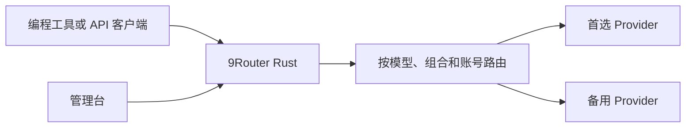

<a id="readme-top"></a>

<div align="center">
  <a href="https://github.com/CoolLoong/9router-rs">
    
  </a>
  <h1>9Router Rust</h1>
  <p>用一个自托管 Rust 网关接入编程工具和模型 API。</p>
  <p>使用 <a href="https://github.com/erkamyaman/rust-anything">rust-anything</a> 迁移到 Rust。</p>
  <p>
    <a href="#快速开始">快速开始</a> ·
    <a href="docs/native-packages.md">原生打包</a> ·
    <a href="https://github.com/CoolLoong/9router-rs/issues">问题与建议</a> ·
    <a href="README.md">English</a>
  </p>
</div>

[![Rust][rust-badge]][rust-site]
[![MIT][license-badge]][project-license]

<details>
  <summary>目录</summary>
<ol>
  <li><a href="#项目简介">项目简介</a>
    <ul>
      <li><a href="#技术栈">技术栈</a></li>
    </ul>
  </li>
  <li><a href="#快速开始">快速开始</a>
    <ul>
      <li><a href="#环境要求">环境要求</a></li>
      <li><a href="#安装与启动">安装与启动</a></li>
    </ul>
  </li>
  <li><a href="#使用方法">使用方法</a>
    <ul>
      <li><a href="#连接账号并创建网关-key">连接账号并创建网关 Key</a></li>
      <li><a href="#客户端与-provider">客户端与 Provider</a></li>
      <li><a href="#api-参考">API 参考</a></li>
      <li><a href="#部署与数据">部署与数据</a></li>
      <li><a href="#排查问题">排查问题</a></li>
    </ul>
  </li>
  <li><a href="#路线图">路线图</a></li>
  <li><a href="#参与贡献">参与贡献</a></li>
  <li><a href="#许可证">许可证</a></li>
  <li><a href="#联系">联系</a></li>
  <li><a href="#致谢">致谢</a></li>
</ol>
</details>

## 项目简介

9Router Rust 把 Provider 账号、网关 Key 和路由策略集中到一个服务里。Claude Code、Codex、Cursor、Cline 和 SDK 通过网关访问已配置的模型。管理台和 CLI 同随原生二进制交付。



请求里的模型 ID 或组合名决定网关如何选择账号。网关负责转换协议，并按客户端要求返回响应。在 **Combos & Vision Adapter** 设定备选模型，即可在首选模型不可用或限流时尝试其他模型。

| 功能 | 用途 |
| --- | --- |
| 路由 | 多账号选择、轮询、顺序回退、模型别名和自定义组合 |
| 凭据 | OAuth、Provider API Key、令牌续期和带访问限制的网关 Key |
| 协议 | OpenAI Chat Completions 和 Responses、Anthropic Messages、Gemini、Ollama |
| 媒体与网页 | 向量、图片和视频生成、语音合成、转录、网页搜索和抓取 |
| 用量 | 额度追踪、用量历史、价格估算和按需启用的请求日志 |
| Token 压缩 | RTK 压缩支持的工具输出，Headroom 压缩请求内容 |
| 管理 | 代理池、Cloudflare Tunnel、Tailscale、密码及 SSO 登录、SQLite 备份恢复 |

### 技术栈

| 组件 | 用途 |
| --- | --- |
| [Rust][rust-site] 与 Cargo | 网关、CLI 和原生打包 |
| Axum 与 Tokio | HTTP 服务和异步请求处理 |
| SQLite | 账号、模型组合、密钥和用量存储 |

<p align="right"><a href="#readme-top">↑ 顶部</a></p>

## 快速开始

### 环境要求

- 稳定版 [Rust 和 Cargo][rust-site]
- 用于构建管理台的 Node.js 22 和 npm
- 本机 C 编译器和链接器，供 SQLite 等依赖编译
- Docker 与 Compose，用于容器部署

### 安装与启动

```sh
git clone https://github.com/CoolLoong/9router-rs.git
cd 9router-rs
npm --prefix dashboard ci
npm --prefix dashboard run build
cargo build --release --locked
```

在 Linux 或 macOS 上用独立的数据目录启动本地网关。

```sh
DATA_DIR="$HOME/.9router-rs" ./target/release/ninerouter --host 127.0.0.1 --port 20128 --no-browser
```

在 Windows PowerShell 中，使用同一构建生成的 Windows 可执行文件。

```powershell
$env:DATA_DIR = Join-Path $HOME ".9router-rs"
.\target\release\ninerouter.exe --host 127.0.0.1 --port 20128 --no-browser
```

<p align="right"><a href="#readme-top">↑ 顶部</a></p>

## 使用方法

### 连接账号并创建网关 Key

1. 打开管理台登录。首次本地启动可以提前设置 `INITIAL_PASSWORD`，也可以用默认密码 `123456` 登录，再到 **Profile & Settings** 修改密码。[打开管理台](http://127.0.0.1:20128/dashboard)
2. 在 **Providers** 添加账号，在 **Models** 选择模型。可以用 **Basic Chat** 试发请求。
3. 在 **Endpoint & Key** 创建网关 Key。客户端填入 API 地址 `http://127.0.0.1:20128/v1`、网关 Key 和目录中显示的完整模型 ID。

### 客户端与 Provider

在管理台的 **CLI Tools** 页面设置各工具使用的模型。原生 CLI 可以配置 Claude Code、Codex、OpenCode、Droid、Crush、Kilo、Cline、Pi 和 OMP。运行 `connect` 时填写网关地址，不带 `/v1`。

```sh
./target/release/ninerouter connect http://127.0.0.1:20128 --tools claude,codex
./target/release/ninerouter show claude codex
```

接入 Cursor 等 OpenAI 兼容客户端时，在工具设置里填入 API 地址、网关 Key 和模型 ID 即可。

内置目录有 145 个 Provider 定义。完整目录和各 Provider 的授权方式见管理台的 **Providers** 页面。

| 接入方式 | 示例 |
| --- | --- |
| OAuth | Claude Code、OpenAI Codex、Gemini CLI、GitHub Copilot、Antigravity、Kiro |
| API Key | OpenAI、Anthropic、Gemini、OpenRouter、Groq、DeepSeek |
| 本地及自定义 | Ollama Local、OpenAI 兼容节点、Anthropic 兼容节点 |

### API 参考

| 方法和路径 | 用途 |
| --- | --- |
| `GET /api/health` | 网关健康检查 |
| `GET /v1/models` | 查询当前调用方可见的模型 |
| `POST /v1/chat/completions` | OpenAI Chat Completions |
| `POST /v1/responses` | OpenAI Responses |
| `POST /v1/messages` | Anthropic Messages |
| `POST /v1beta/models/{model}:generateContent` | Gemini 文本生成 |
| `POST /v1/embeddings` | 向量生成 |
| `POST /v1/images/generations` | 图片生成 |
| `POST /v1/audio/speech` · `POST /v1/audio/transcriptions` | 语音合成与转录 |
| `POST /v1/videos/generations` · `GET /v1/videos/{id}` | 提交并查询视频任务 |
| `POST /v1/search` · `POST /v1/web/fetch` | 网页搜索与抓取 |

将 **Endpoint & Key** 创建的网关 Key 放进 Bearer 鉴权头。下面以 OpenAI 模型为例，实际请求可替换成模型列表中你已配置的模型 ID。

```sh
BASE=http://127.0.0.1:20128
KEY='your-gateway-key'

curl -fsS "$BASE/api/health"
curl -fsS "$BASE/v1/models" -H "Authorization: Bearer $KEY"
curl -fsS "$BASE/v1/chat/completions" \
  -H "Authorization: Bearer $KEY" \
  -H "Content-Type: application/json" \
  -d '{"model":"openai/gpt-5.4-mini","messages":[{"role":"user","content":"你好"}]}'
```

### 部署与数据

#### Docker Compose

复制环境变量示例。

```sh
cp .env.example .env
```

在 `.env` 设置 `INITIAL_PASSWORD`，再从当前源码构建并启动容器。

```sh
docker compose up -d --build
```

Compose 发布 `20128` 端口，将 `9router-data` 卷挂载到 `/app/data`，并在同一网络启动 Headroom。仅供本机访问时，可将端口映射设为 `127.0.0.1:20128:20128`。

#### 环境变量

| 变量 | 用途 |
| --- | --- |
| `DATA_DIR` | 数据目录。Linux 和 macOS 默认为 `~/.9router`，Windows 默认为 `%APPDATA%\9router`。 |
| `PORT` | 未传 `--port` 时使用的网关端口，默认为 `20128`。 |
| `INITIAL_PASSWORD` | 管理台尚未保存密码时使用的初始密码。 |
| `JWT_SECRET` | 管理台会话签名密钥。网关可自动生成并保存在 `DATA_DIR`。 |
| `BASE_URL` | 通过反向代理部署时，OIDC 跳转使用的外部地址。 |
| `HEADROOM_URL` | 请求压缩使用的 Headroom 服务地址。 |
| `ENABLE_REQUEST_LOGS` | 设为 `true` 启用请求日志。 |

SQLite 文件位于 `DATA_DIR/db/data.sqlite`。接管已有安装前先备份数据目录，也可在管理台的 **Profile & Settings** 导出数据库。

#### 原生打包

用 Cargo 打包工具生成 Linux 或 macOS 的 tar.gz 归档，以及 Windows 的 ZIP 归档。归档包含程序和依赖许可。[打包与签名更新](docs/native-packages.md)

### 排查问题

| 现象 | 排查方式 |
| --- | --- |
| 客户端收到 HTTP 401 | 使用 **Endpoint & Key** 签发的网关 Key，并检查该 Key 的访问规则。 |
| 模型找不到或无法调用 | 在 **Providers** 检查账号，使用 `GET /v1/models` 返回的完整模型 ID。 |
| 上游返回 HTTP 429 | 到 **Quota Tracker** 检查额度。可以添加账号，或在组合里配置备用模型。 |

<p align="right"><a href="#readme-top">↑ 顶部</a></p>

## 路线图

Linux 工作区和无默认特性配置的编译检查由 [Rust CI](https://github.com/CoolLoong/9router-rs/actions/workflows/rust.yml) 运行。待办和功能建议在 [GitHub Issues](https://github.com/CoolLoong/9router-rs/issues) 跟踪。

## 参与贡献

提交 Pull Request 前，在本地执行格式检查和编译检查。改动 API 或 CLI 时，请同步更新用法说明。

```sh
npm --prefix dashboard run build
cargo fmt --all -- --check
cargo check --locked --workspace
cargo check --locked --no-default-features
```

| 路径 | 内容 |
| --- | --- |
| `src/` | 网关、Provider、管理台、CLI 和内嵌资源 |
| `dashboard/` | 原版 React 管理台源码和前端构建 |
| `crates/` | 内部 Rust 库 |
| `tools/package/` | 原生归档和依赖许可清单 |

<p align="right"><a href="#readme-top">↑ 顶部</a></p>

## 许可证

项目使用 [MIT 许可证][project-license]。原生归档附带项目、内嵌资源和依赖的许可文件。

## 联系

在 [GitHub Issues](https://github.com/CoolLoong/9router-rs/issues) 报告问题或提出建议。涉及 Provider 时，可附上 Provider 名称、模型 ID、版本和返回的 HTTP 状态。

## 致谢

- 上游 [decolua/9router](https://github.com/decolua/9router/tree/1855aa44473e88feac9d3f131b9c0c5fc9706b68) 提供了迁移基线，对应提交 `1855aa4`。
- [rust-anything](https://github.com/erkamyaman/rust-anything) 用于生成迁移骨架，并回放旧版记录以核对 Rust 实现的行为。
- README 布局参考 [Best-README-Template](https://github.com/othneildrew/Best-README-Template)。

<p align="right"><a href="#readme-top">↑ 顶部</a></p>

[rust-badge]: https://img.shields.io/badge/Rust-Cargo-DEA584?logo=rust
[rust-site]: https://www.rust-lang.org/
[license-badge]: https://img.shields.io/badge/license-MIT-blue
[project-license]: LICENSE
